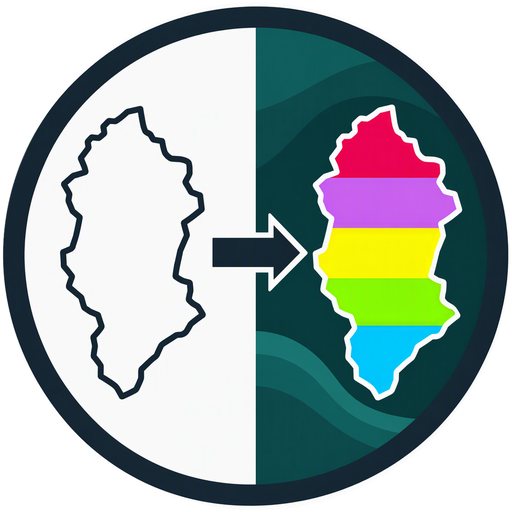

<p align="center">
  
</p>

<h1 align="center">qml2lyrx</h1>

<p align="center">
  Convert QGIS layer styles (<code>.qml</code>) into ArcGIS Pro layer files (<code>.lyrx</code>) and styles (<code>.stylx</code>).
</p>

<p align="center">
  
  
  
  
  
</p>

> **Version:** 0.1.0
> **Requires:** Python 3.9+ or the standalone `.exe` · ArcGIS Pro 3.x

## Overview

**qml2lyrx** takes a symbology style prepared in QGIS and writes the equivalent
layer file for ArcGIS Pro. ArcGIS Pro cannot import QML, so thematic maps built
on open data — land cover, land use, administrative boundaries — usually have to
be recoloured by hand. This tool reads the QML rules and writes the CIM JSON
that Pro expects.

The reference case is the Portuguese **COS25v1** land cover style: 102 rules on
`cos25v1_n4_c` become 101 classes with the same colours, in one command.

## How it works

A `.qml` is XML, a `.lyrx` is JSON. The program is the bridge between them.

In the QML, a rule points at a symbol, and the symbol holds the colour:

```xml
<rule filter=""campo = '1.1.1.1'"" symbol="0"/>
<symbol name="0">
  <Option name="color" value="230,0,77,255"/>
```

In the `.lyrx`, the same information becomes one class of a unique-values renderer:

```json
{
  "label": "1.1.1.1 Áreas edificadas…",
  "values": [{ "fieldValues": ["1.1.1.1"] }],
  "symbol": { "symbolLayers": [{ "color": { "values": [230, 0, 77, 100] } }] }
}
```

| function | what it does |
|---|---|
| `ler_qml()` | walks `<rules>` / `<categories>` and returns `[(value, label, colour), …]` |
| `renderer()` | puts that list into the Pro renderer: one class per value |
| `camada()` | the layer template — fixed JSON, copied from a real `.lyrx` |

Only the first two are logic. The third is a form the Pro insists on.

## What is converted

| QGIS renderer | ArcGIS Pro |
|---|---|
| `singleSymbol` | Single Symbol |
| `categorizedSymbol` | Unique Values |
| `RuleRenderer` with `field = value` rules | Unique Values |
| `else` rule | "all other values" symbol |

| QGIS symbol | ArcGIS Pro |
|---|---|
| `SimpleFill` (colour, outline, width) | `CIMPolygonSymbol` |
| `SimpleLine` (colour, width, dash pattern) | `CIMLineSymbol` |
| `SimpleMarker`, SVG, fonts | not yet |

Fidelity notes:

- QGIS alpha 0–255 → CIM alpha 0–100;
- widths in mm / pixel / inch → points;
- `outline_style = no` gives a symbol with no stroke, not a transparent one;
- rules sharing the same value: the first wins and a warning names the one
  dropped (the COS25v1 has `1.4.1.3` twice);
- **shapefiles:** the DBF truncates field names to 10 characters
  (`cos25v1_n4_c` → `cos25v1_n4`), so every `.lyrx` also writes a
  `*_shapefile.lyrx` twin with the truncated name.

## Quick start (no command line)

Copy `qml2lyrx.exe` (or `qml2lyrx.py`) and `correr.bat` next to the data, or
drop a folder or a `.zip` on top of `correr.bat`. It scans the folder, reads the
styles stored in the GeoPackages, writes a `converter.ini` and converts
everything:

```
data/
├── correr.bat
├── qml2lyrx.exe
├── geopackages/            ← drop .gpkg or .zip here (git-ignored)
│   ├── cos2025v1.gpkg
│   └── converter.ini       ← generated, editable
└── out/
    └── cos2025v1_2026-11-09/
        ├── COS25v1_n4.lyrx            layer with symbology
        ├── COS25v1_n4.stylx           101 symbols as a style
        ├── COS25v1_n4_shapefile.lyrx  same, field name truncated
        └── ...
```

Zipped GeoPackages are extracted once, next to the zip — ArcGIS Pro cannot read
inside a zip, so the `.lyrx` must point at a file on disk.

## Command line

```bash
python qml2lyrx.py --folder "C:\data"           # scan, write converter.ini, convert
python qml2lyrx.py --folder "C:\data" --force   # rebuild converter.ini
python qml2lyrx.py estilo.qml out.lyrx -s dados.gpkg -d camada
python qml2lyrx.py "dados.gpkg#COS25v1_n4" out.lyrx -d camada
python qml2lyrx.py "dados.gpkg#COS25v1_n4" out_COS25v1_n4.stylx   # style only
```

`-c/--field` overrides the field name when the destination uses another one.
The Portuguese spellings (`--pasta`, `--forcar`, `--descobrir`, `--campo`) still
work.

## The `converter.ini`

One section per layer; the section name is the layer name in Pro:

```ini
[COS25v1_N4]
style  = geopackages/cos2025v1.gpkg#COS25v1_n4
layer  = cos2025v1
output = out/cos2025v1_2026-11-09/COS25v1_n4.lyrx
```

`data` is optional (defaults to the GeoPackage the style came from) and paths
are relative to the `.ini`. If a style is stored on a GeoPackage **view**, the
configuration points at the real table — Pro may not list views — and leaves the
view as a commented line.

## Installation

```bash
pip install .
```

or download `qml2lyrx.exe` from the GitHub **Releases** page. No third-party
Python dependencies.

## Building the `.exe`

```bash
construir-exe.bat
```

`.github/workflows/exe.yml` builds the same executable on every `v*` tag and
uploads it as an artifact.

## Repository structure

```text
qml2lyrx/
├── qml2lyrx.py
├── correr.bat
├── construir-exe.bat
├── exemplo.qml
├── test_qml2lyrx.py
├── assets/
│   └── logo.png
├── .github/
│   └── workflows/
│       └── exe.yml
├── pyproject.toml
├── README.md
├── CHANGELOG.md
├── CITATION.cff
├── .gitignore
└── LICENSE
```

## Validation

- The generated `.lyrx` was checked type by type and key by key against **107
  layer files shipped with ArcGIS Pro 3.7** — every type and key written exists
  there, and every always-present key is present.
- The class table was diffed against the QGIS style stored inside the COS25v1
  GeoPackage: 101 codes, 101 labels, 101 colours, no differences.
- `python -m unittest test_qml2lyrx` covers the real COS25v1 style, a synthetic
  GeoPackage, a zip, and the `.stylx` writer.

The `.stylx` layout was copied from a style installed by ArcGIS Pro, but unlike
the `.lyrx` it has **not** been opened in Pro during development.

## Limitations

- point symbols, graduated renderers and expressions in rule filters are not
  converted — the tool fails loudly instead of writing a wrong file;
- labels, opacity, blend modes and 3D are not carried over;
- dashed lines are drawn solid (with a warning);
- ArcGIS Pro does not remap unique-value fields, so shapefile targets need the
  `*_shapefile.lyrx` twin.

## Citation

Machine-readable citation metadata are available in `CITATION.cff`.

## License

Released under the **GNU General Public License v3.0**.

## Author

**Pedro Goncalves**
